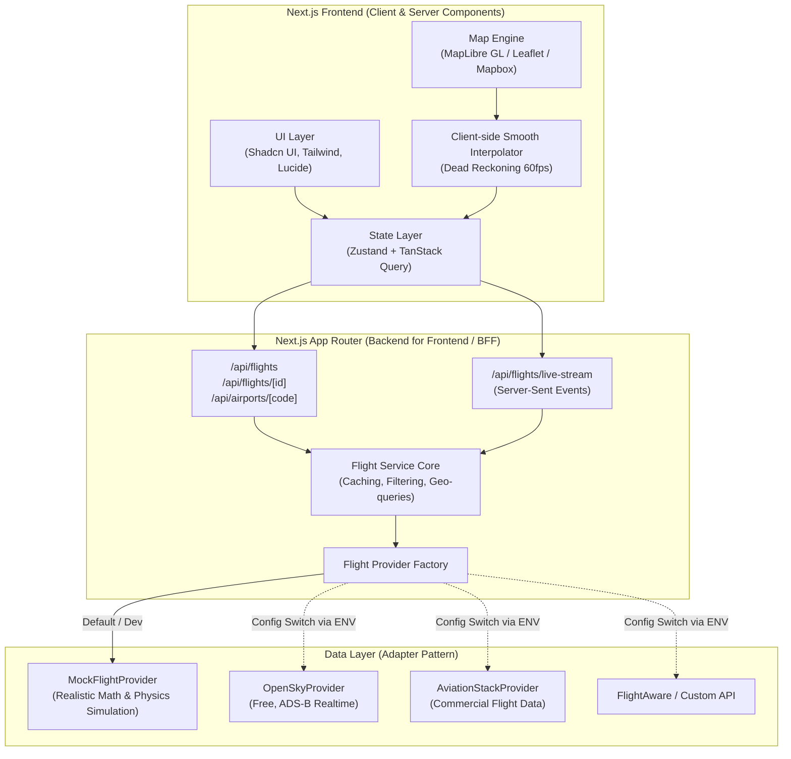

# ✈️ Next.js Flight Tracker — System Architecture & Implementation Plan

> **Version:** 1.0.0  
> **Target Framework:** Next.js 15+ (App Router, React 19, TypeScript)  
> **Status:** Draft / Ready for Implementation  
> **Core Objective:** Build a modular, high-performance real-time Flight Tracker web application with an interchangeable **Adapter Pattern** data layer (starting with a rich Mock API / Simulation Engine, easily switchable to production APIs like OpenSky, AviationStack, or FlightRadar24).

---

## 📑 Table of Contents
1. [Executive Summary & High-Level Architecture](#1-executive-summary--high-level-architecture)
2. [Technology Stack & Decided Choices](#2-technology-stack--decided-choices)
3. [Core Architectural Patterns (Future-Proof Design)](#3-core-architectural-patterns-future-proof-design)
4. [Data Domain Models & Type Definitions](#4-data-domain-models--type-definitions)
5. [Mock API & Flight Simulation Engine](#5-mock-api--flight-simulation-engine)
6. [Frontend UI & Component Architecture](#6-frontend-ui--component-architecture)
7. [Mapping & Spatial Visualization Strategy](#7-mapping--spatial-visualization-strategy)
8. [Folder & Project Structure](#8-folder--project-structure)
9. [Step-by-Step Implementation Roadmap](#9-step-by-step-implementation-roadmap)
10. [Future Real API Migration Guide](#10-future-real-api-migration-guide)
11. [Decided Architecture Specifications](#11-decided-architecture-specifications)

---

## 1. Executive Summary & High-Level Architecture

The **Flight Tracker** application gives users an interactive, real-time map displaying worldwide aircraft movements, telemetry (altitude, speed, heading), airport departure/arrival boards, and search/filtering features.

### Architecture Diagram (C4 Container View)



---

## 2. Technology Stack & Decided Choices

| Layer | Chosen Technology | Rationale & Selection |
| :--- | :--- | :--- |
| **Framework** | **Next.js 15 (App Router)** | Full-stack capabilities, React Server Components (RSC), optimized Route Handlers for BFF layer, streaming SSR. |
| **Language** | **TypeScript 5+ (Strict Mode)** | Enterprise-grade type safety across domain entities (`Flight`, `Airport`, `Waypoint`). |
| **Styling & UI** | **Tailwind CSS + Shadcn UI (Radix UI)** | **Dark Aviation Radar Theme**: Jet black / deep navy backdrop (`#0B0F19`), neon cyan (`#06B6D4`) and amber (`#F59E0B`) cockpit accents (FlightRadar24 style). |
| **Icons & Visuals** | **Lucide React + Framer Motion** | Crisp cockpit/flight instrumentation icons and fluid UI transitions. |
| **Interactive Map** | **MapLibre GL JS** | **Decided Map Engine**: 100% open-source WebGL vector rendering, 60fps smooth aircraft marker rotation, zero API token fees, CARTO dark-matter vector basemap. |
| **State Management** | **Zustand + TanStack Query (v5)** | TanStack Query for server caching/polling, Zustand for map viewport state, selected aircraft, radar sweep effects. |
| **Realtime Updates** | **Server-Sent Events (SSE)** + Polling Fallback | Lightweight unidirectional real-time coordinates streaming without heavyweight WebSocket server setup. |
| **Validation** | **Zod** | Runtime schema validation for API responses and configuration environments. |

---

## 3. Core Architectural Patterns (Future-Proof Design)

The primary requirement is that **the mock data can be replaced seamlessly with a real aviation API in the future without touching the UI or business logic**.

To achieve this, we use the **Repository / Adapter Pattern**:

```
[UI Components] 
       ↓
[Next.js API Routes / Server Actions]
       ↓
[FlightService (Business Logic, In-Memory Caching)]
       ↓
[IFlightDataProvider (Interface / Contract)]
       ├── MockFlightProvider (Current: Generates dynamic simulated flights)
       ├── OpenSkyFlightProvider (Future)
       ├── AviationStackFlightProvider (Future)
       └── FlightAwareFlightProvider (Future)
```

### The Provider Interface Contract (`lib/contracts/flight-provider.interface.ts`)
```typescript
export interface IFlightDataProvider {
  readonly providerName: string;
  
  // Get active flights (optional bounding box filter for map viewport)
  getLiveFlights(params?: BoundingBoxFilter): Promise<FlightSummary[]>;
  
  // Get detailed information for a single flight
  getFlightDetails(flightId: string): Promise<FlightDetail | null>;
  
  // Search flights by flight number, callsign, or airline
  searchFlights(query: string): Promise<FlightSummary[]>;
  
  // Get airport schedule (arrivals & departures)
  getAirportSchedule(airportIata: string): Promise<AirportSchedule>;
  
  // Check provider health / quota limits
  getHealthStatus(): Promise<{ status: 'OK' | 'DEGRADED' | 'DOWN'; quotaRemaining?: number }>;
}
```

### Provider Factory (`lib/services/provider-factory.ts`)
```typescript
export function getFlightDataProvider(): IFlightDataProvider {
  const providerType = process.env.FLIGHT_DATA_PROVIDER || 'MOCK';

  switch (providerType.toUpperCase()) {
    case 'OPENSKY':
      return new OpenSkyFlightProvider();
    case 'AVIATIONSTACK':
      return new AviationStackFlightProvider();
    case 'MOCK':
    default:
      return new MockFlightProvider();
  }
}
```
> **Benefit:** When switching to a real API, you only build one new class (`OpenSkyFlightProvider.ts`), test it against the interface, and change an environment variable (`FLIGHT_DATA_PROVIDER=OPENSKY`). Zero changes required in UI components!

---

## 4. Data Domain Models & Type Definitions

Defined in `types/flight.ts` and `types/airport.ts`:

```typescript
export type FlightStatus = 
  | 'SCHEDULED' 
  | 'ACTIVE' 
  | 'EN_ROUTE' 
  | 'APPROACHING' 
  | 'LANDED' 
  | 'DIVERTED' 
  | 'DELAYED' 
  | 'CANCELLED';

export interface Coordinates {
  latitude: number;
  longitude: number;
  altitudeFt: number;
}

export interface Telemetry extends Coordinates {
  headingDeg: number;       // 0 - 360 degrees
  groundSpeedKts: number;   // knots
  verticalSpeedFpm: number; // feet per minute (+ climbing, - descending)
  squawk?: string;          // transponder code e.g. "7700"
}

export interface AirportBrief {
  iata: string;             // e.g. "DAC", "DXB", "LHR", "JFK"
  icao: string;             // e.g. "VGHS", "OMDB", "EGLL", "KJFK"
  name: string;
  city: string;
  country: string;
  timezone: string;
  terminal?: string;
  gate?: string;
}

export interface AirlineBrief {
  iata: string;             // e.g. "BG", "EK", "BA"
  icao: string;             // e.g. "BBC", "UAE", "BAW"
  name: string;             // e.g. "Biman Bangladesh Airlines", "Emirates"
  logoUrl?: string;
}

export interface AircraftInfo {
  model: string;            // e.g. "Boeing 787-9 Dreamliner", "Airbus A350-900"
  registration: string;     // e.g. "S2-AJX"
  icao24: string;           // Transponder hex code
}

export interface Waypoint extends Coordinates {
  timestamp: string;
}

export interface FlightSummary {
  id: string;               // Unique internal ID
  flightNumber: string;     // e.g. "BG001", "EK582"
  callsign: string;         // e.g. "BBC001"
  airline: AirlineBrief;
  aircraft: AircraftInfo;
  origin: AirportBrief;
  destination: AirportBrief;
  status: FlightStatus;
  telemetry: Telemetry;
  progressPercent: number;  // 0 - 100
}

export interface FlightDetail extends FlightSummary {
  scheduledDeparture: string; // ISO String
  actualDeparture?: string;
  scheduledArrival: string;
  estimatedArrival?: string;
  delayMinutes: number;
  routeHistory: Waypoint[];  // Coordinates traversed so far
  projectedRoute: Coordinates[]; // Remaining flight path (Great Circle route)
  weatherConditions?: {
    origin: { tempC: number; windKts: number; visibilityKm: number; condition: string };
    destination: { tempC: number; windKts: number; visibilityKm: number; condition: string };
  };
}
```

---

## 5. Mock API & Flight Simulation Engine

To make the mock API look and feel identical to real live radar data (like FlightRadar24 or FlightAware):

### 5.1 Physics & Mathematics Engine (`lib/simulation/geo-math.ts`)
- **Great Circle Path Calculation:** Generates realistic curved flight paths between any two global airports using the Haversine & Spherical Trigonometry formulas.
- **Bearing Calculation:** Dynamically calculates true heading (`0° - 360°`) as planes move along waypoints.
- **Dead Reckoning Interpolation:** Calculates next `lat, lng, altitude, speed` every tick ($T = 3-5\text{s}$).

### 5.2 Dynamic Flight Generator (`lib/simulation/flight-generator.ts`)
- Pre-seeds **50–100 realistic global flights** across major international routes:
  - Asian & Middle Eastern Corridors: `DAC ↔ DXB`, `DAC ↔ SIN`, `BKK ↔ DOH`, `DEL ↔ LHR`
  - Transatlantic Corridors: `JFK ↔ LHR`, `CDG ↔ EWR`
  - Domestic & Regional routes
- Simulates realistic states:
  - Takeoff phase (Altitude climbing, speed increasing)
  - Cruising phase (Stable altitude 33,000–41,000 ft, ~480–540 kts)
  - Descent & Landing phase (Descending altitude, decreasing speed)
  - Loop resets: Once a flight lands, it turns around or is replaced by a scheduled departure.

### 5.3 Streaming & Polling Endpoints
1. `GET /api/flights`: Returns all active flights (with support for `?bounds=minLat,minLng,maxLat,maxLng` for viewport culling).
2. `GET /api/flights/[id]`: Returns full route history, aircraft specs, and projected path.
3. `GET /api/flights/live-stream`: Server-Sent Events (SSE) emitting coordinate updates every 3 seconds.

---

## 6. Frontend UI & Component Architecture

### Layout Hierarchy

```
app/
├── (dashboard)/
│   ├── layout.tsx         # Fullscreen Radar Map Layout
│   └── page.tsx           # Main Flight Tracker Interactive View
```

### Component Breakdown
```
components/
├── map/
│   ├── FlightMap.tsx             # Main MapLibre/Leaflet WebGL container
│   ├── AircraftMarker.tsx        # Plane icon with dynamic SVG rotation & altitude glow
│   ├── FlightPathPolyline.tsx    # 3D gradient curved line showing flight trail
│   ├── AirportMarker.tsx         # Airport pulse radar rings
│   └── MapControls.tsx           # Zoom, Style picker (Dark Radar / Satellite / Terrain)
│
├── sidebar/
│   ├── SearchFilterBar.tsx       # Search by Flight #, Airline, Origin, Destination
│   ├── FlightList.tsx            # Virtualized list of active flights
│   ├── FlightCardItem.tsx        # Compact card with flight status, route, and ETA
│   └── AirlineFilterDropdown.tsx # Multi-select filter for airlines
│
├── flight-detail/
│   ├── FlightDetailSheet.tsx     # Slide-over panel for selected flight
│   ├── TelemetryGauges.tsx       # Altitude meter, ground speed gauge, vertical speed
│   ├── RouteProgressMeter.tsx    # Timeline from Origin Gate to Destination Gate
│   └── AircraftSpecsCard.tsx     # Aircraft model, photo, age, registration
│
├── airport/
│   ├── AirportBoardModal.tsx     # FIDS style (Flight Information Display System) Arrivals/Departures
│   └── WeatherBadge.tsx          # METAR / Local weather at airport
│
└── common/
    ├── StatusBadge.tsx           # Colored status pill (Active, Delayed, Diverted)
    └── LiveIndicator.tsx         # Pulsing green "LIVE RADAR" badge with sync status
```

---

## 7. Mapping & Spatial Visualization Strategy

| Feature | Implementation Technique |
| :--- | :--- |
| **Map Engine** | **MapLibre GL JS** (Open-source fork of Mapbox GL, zero subscription cost, supports high-res vector tiles via CARTO or OpenStreetMap). |
| **Marker Performance** | GeoJSON source + Symbol Layer / Custom Canvas Markers to support 500+ simultaneous moving planes without frame drops. |
| **Smooth Movement** | **Linear / Great Circle Interpolation (Client)**: When the server sends a coordinate update every 3s, the client smoothly animates the plane icon over the 3-second window using `requestAnimationFrame`. |
| **Path Rendering** | Turf.js `greatCircle()` to draw accurate curved paths taking the curvature of the Earth into account. |

---

## 8. Folder & Project Structure

```
flight-tracker/
├── app/
│   ├── api/
│   │   ├── flights/
│   │   │   ├── route.ts                 # GET /api/flights (all or filtered)
│   │   │   ├── [id]/
│   │   │   │   └── route.ts             # GET /api/flights/:id
│   │   │   └── live-stream/
│   │   │       └── route.ts             # SSE stream for live telemetry
│   │   └── airports/
│   │       └── [iata]/
│   │           └── route.ts             # GET /api/airports/:iata (schedules)
│   ├── layout.tsx                       # Root layout & font injection
│   ├── page.tsx                         # Main flight tracker dashboard
│   └── globals.css                      # Tailwind styles & radar animations
│
├── components/                          # React components (modular UI)
│   ├── map/                             # Map container, markers, polylines
│   ├── sidebar/                         # Search, filter, active flight lists
│   ├── flight-detail/                   # Cockpit telemetry, gauges, route info
│   └── ui/                              # Shadcn UI primitives (button, dialog, etc.)
│
├── lib/
│   ├── contracts/
│   │   └── flight-provider.interface.ts # The Interface all providers must implement
│   ├── providers/
│   │   ├── mock/
│   │   │   ├── mock-flight-provider.ts  # Mock provider implementing interface
│   │   │   ├── mock-flights-data.ts     # Pre-seeded routes & aircraft
│   │   │   └── mock-airports-data.ts    # Global airports database
│   │   ├── opensky/                     # Future: OpenSky Network API adapter
│   │   │   └── opensky-provider.ts
│   │   └── aviationstack/               # Future: AviationStack API adapter
│   │       └── aviationstack-provider.ts
│   ├── services/
│   │   ├── flight-service.ts            # Central flight business service
│   │   └── provider-factory.ts          # Dynamically picks Mock vs Real provider
│   ├── simulation/
│   │   ├── geo-math.ts                  # Great circle, bearing, distance formulas
│   │   └── flight-simulator.ts          # In-memory ticker updating positions
│   └── utils.ts
│
├── store/
│   └── useFlightStore.ts                # Zustand store: selectedFlight, filters, mapState
│
├── types/
│   ├── flight.ts                        # TypeScript flight & telemetry interfaces
│   └── airport.ts                       # TypeScript airport & route interfaces
│
├── public/
│   ├── icons/                           # Airplane icons, airline logos
│   └── markers/                         # SVG map pins
│
├── .env.example                         # Environment variable blueprint
├── architecture.md                      # This architecture specification
├── package.json
├── tailwind.config.ts
└── tsconfig.json
```

---

## 9. Step-by-Step Implementation Roadmap

### Phase 1: Foundation & Project Bootstrapping
- [ ] Initialize Next.js 15 project with TypeScript, Tailwind CSS, Lucide Icons, and ESLint.
- [ ] Configure Shadcn UI components (Card, Sheet, Dialog, Tabs, Input, Badge).
- [ ] Establish Domain Models (`types/flight.ts`, `types/airport.ts`).

### Phase 2: Mock API & Simulation Engine
- [ ] Create `lib/contracts/flight-provider.interface.ts`.
- [ ] Build math utilities (`lib/simulation/geo-math.ts`) for Great Circle coordinates & bearing.
- [ ] Build `MockFlightProvider` with 50+ international and regional flights.
- [ ] Set up Next.js Route Handlers:
  - `GET /api/flights`
  - `GET /api/flights/[id]`
  - `GET /api/flights/live-stream` (SSE)

### Phase 3: Interactive Radar Map
- [ ] Set up MapLibre GL JS / Leaflet map viewport with Dark Radar theme.
- [ ] Implement aircraft SVG markers with dynamic rotation based on `headingDeg`.
- [ ] Implement smooth client-side interpolation between coordinate ticks.
- [ ] Draw selected flight trajectory (traveled path vs remaining path).

### Phase 4: UI Dashboard & Cockpit Instrumentation
- [ ] Build floating search & filter drawer (Filter by Flight #, Airline, Status).
- [ ] Build Flight Detail Panel with cockpit-style telemetry gauges (Altitude, Speed, Vertical Speed, ETA).
- [ ] Add Airport Schedule Drawer (Arrivals & Departures table).

### Phase 5: Polish & Real API Readiness
- [ ] Implement Provider Factory and test switching providers via `.env`.
- [ ] Add loading skeletons, offline states, and error boundary handling.
- [ ] Add unit tests for `geo-math` and provider contracts.

---

## 10. Future Real API Migration Guide

When you are ready to switch from Mock to a real Flight API, follow this simple 3-step checklist:

1. **Obtain API Credentials:**
   - E.g., OpenSky Network (Free/Open), AviationStack, FlightAware, or AeroDataBox.
2. **Implement the Adapter Class:**
   - Create `lib/providers/your-api/your-api-provider.ts` implementing `IFlightDataProvider`.
   - Map external JSON response to the standard `FlightSummary` and `FlightDetail` types.
3. **Change Environment Variable:**
   ```bash
   # In .env.local:
   FLIGHT_DATA_PROVIDER=OPENSKY
   OPENSKY_USERNAME=your_username
   OPENSKY_PASSWORD=your_password
   ```
   *No frontend components need modification!*

---

## 11. Decided Architecture Specifications

The following design decisions have been locked in for this project:

- ✅ **Map Engine:** **MapLibre GL JS** — High FPS WebGL vector rendering, open-source with no API key locks, paired with CARTO Dark Matter vector tiles.
- ✅ **Visual Theme:** **Dark Aviation Radar Theme** — High-contrast cockpit radar style with Jet Black background, neon cyan telemetry indicators, and amber alert badges.
- ✅ **Mock Route Coverage:** **Global + Regional Mix** — International flight hubs (DAC ↔ DXB, DAC ↔ LHR, SIN ↔ DAC, JFK ↔ LHR) along with domestic Bangladesh connections (Dhaka DAC, Chittagong CGP, Sylhet ZYL, Cox's Bazar CXB, Saidpur SPD).
